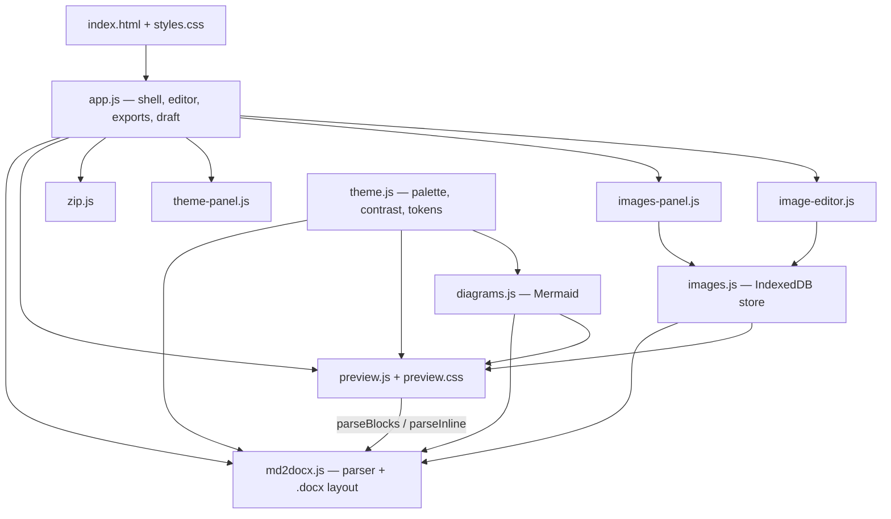

# Markdown to Word

Turn a Markdown file into a properly styled Word document — cover page, table of contents, Mermaid
diagrams, full-resolution images and a consistent colour theme — without a build step, an account or
an upload. Serve `index.html` from any static web server and the whole converter runs in the browser
tab.


```text
your .md  ──►  live preview that mirrors Word  ──►  .docx · .html · .pdf · .md · .zip
```

---

## Contents

- [Why this exists](#why-this-exists)
- [Quick start](#quick-start)
- [The workspace](#the-workspace)
- [Keyboard shortcuts](#keyboard-shortcuts)
- [Export formats](#export-formats)
- [How Markdown becomes Word](#how-markdown-becomes-word)
- [Supported Markdown](#supported-markdown)
- [Images](#images)
- [Diagrams](#diagrams)
- [Themes](#themes)
- [Word output in detail](#word-output-in-detail)
- [Architecture](#architecture)
- [Project tools and dependencies](#project-tools-and-dependencies)
- [Data stored in your browser](#data-stored-in-your-browser)
- [Privacy and security](#privacy-and-security)
- [Limits and known behaviour](#limits-and-known-behaviour)
- [Browser support](#browser-support)
- [Developing](#developing)
- [Licensing](#licensing)

---

## Why this exists

Pandoc-quality Word output usually means installing a toolchain, or pasting your document into a web
service. This project does the conversion where the document already is — in the browser — and aims
the output at the kind of document people actually hand over: a titled, versioned, paginated report
with a contents page, tables that fit the margins, and diagrams that print.

| Goal | How it is met |
|------|---------------|
| Nothing leaves the machine | No network calls except the page's own files; no server, no account, no telemetry |
| Nothing to install | Static files only — no npm, no bundler, no transpiler |
| What you see is what Word gets | The preview uses the *same parser* as the `.docx` writer and mirrors its layout rules |
| Documents that look finished | Cover page, running header and footer, generated TOC, styled tables, callouts, figure captions |
| Images survive the trip | Originals go into Word byte-for-byte where Word can read them; everything else is re-encoded at full resolution |

---

## Quick start

The app is made of ES modules, so it must be served over HTTP — opening `index.html` straight from
the file system will not work.

```bash
git clone https://github.com/ahmadner/md-to-word.git
cd md-to-word
python -m http.server 8000
```

Then open <http://localhost:8000>.

Any static server works just as well:

```bash
npx --yes serve .
```

### Deploy it

The repository is a complete static site. Push it to **GitHub Pages** (or any static host) and it
works as-is — `.nojekyll` is already there so the `vendor/` directory is published untouched. On a
`user.github.io/repo/` URL the start page automatically shows a *Source on GitHub* link back to the
repository.

### First run

1. Drop a `.md` file on the page, choose one, **Open the sample file**, or **Start a blank document**.
2. Edit on the left; the preview on the right updates as you type.
3. **Export ▸ Word document** (or `.html`, `.pdf`, `.md`, `.zip`).

When Word opens the exported file it asks whether to update the fields in it — answer **Yes** so the
table of contents gets its page numbers.

---

## The workspace

| Area | What it does |
|------|--------------|
| **Views** | **Edit**, **Split** or **Preview**. Below 860 px the split view collapses to Edit/Preview without overwriting your desktop preference |
| **Toolbar** | Heading (cycles `##` → `###` → `####` → none), bold, italic, strikethrough, inline code, link, bulleted list, numbered list, note box, code block, table, Mermaid diagram, image |
| **Outline** | Every heading, at its Word level; clicking one scrolls the preview *and* selects the line in the editor |
| **Status bar** | Live counts of words, lines, headings, diagrams and images, plus the draft state |
| **File name** | Editable in the top bar; it becomes the export file name and the title in the running header |
| **Images panel** | Thumbnail, format, pixel size and file size for every stored image; insert, edit, download, delete — plus a list of paths the text references but has no file for |
| **Theme panel** | Presets, the 60-30-10 palette, fonts, per-element colour overrides, import/export, and the app's own light/dark appearance |
| **Draft** | Text and images are kept in this browser; reloading, or **Continue editing** on the start page, brings them back. Opening another document replaces the draft and warns first if the current one has unexported changes |
| **Drag and drop** | Drop a `.md`, a `.zip` or image files anywhere on the page |
| **Paste** | Paste a screenshot straight into the editor; it is stored as `images/pasted-<timestamp>.png` and referenced at the cursor |

---

## Keyboard shortcuts

| Keys | Action |
|------|--------|
| `Ctrl`/`Cmd` + `B` | Bold — toggles, so selecting already-bold text unwraps it |
| `Ctrl`/`Cmd` + `I` | Italic |
| `Ctrl`/`Cmd` + `K` | Link, with the URL pre-selected |
| `Ctrl`/`Cmd` + `S` | Export the Markdown file |
| `Tab` / `Shift`+`Tab` | Indent / outdent the selected lines by two spaces; on a non-list line `Tab` inserts two spaces |
| `Enter` | Continues a bulleted or numbered list; on an empty item it ends the list |
| `Esc` | Leaves the editor (so `Tab` can reach the rest of the page), closes the export menu or a side panel |
| `↑` / `↓` | Move through the export menu |

All editing commands go through the browser's own editing pipeline, so `Ctrl`+`Z` undoes them.

---

## Export formats

| Format | File | What you get |
|--------|------|--------------|
| **Word** | `.docx` | A4 document with cover page, field-based TOC, running header and footer, styled tables, callouts, code boxes, diagrams as 3× PNGs and images at full resolution |
| **Markdown** | `.md` | Your text exactly as edited. Images are *not* inside it — the app says so if the document has any |
| **Markdown + images** | `.zip` | The `.md` plus its `images/` folder, so the document renders correctly on GitHub or in another editor. Re-open the `.zip` here to carry on editing |
| **Web page** | `.html` | One self-contained file: the preview markup, `preview.css` inlined, theme variables applied and every image embedded as a full-resolution data URI |
| **PDF** | — | Opens the browser's print dialog against a print stylesheet: the cover and the contents each get their own page, every Heading 1 starts a new page, and tables, code boxes, callouts and diagrams avoid page breaks |

The Word library (1.4 MB) is fetched only the first time you export a `.docx`; Mermaid is fetched
only when a document actually contains a diagram.

---

## How Markdown becomes Word

The converter recognises a small set of document conventions on top of ordinary Markdown.

| In the Markdown | In the Word document and the preview |
|-----------------|--------------------------------------|
| A **single** `# Title` | Becomes the cover page. Text before a ` - ` (or en/em dash) becomes the small upper-case kicker above the title |
| A **two-column table immediately after** the title | Becomes the cover details table. Recognised keys also fill the subtitle, header and footer — see below |
| `## Contents` or `## Table of Contents` | Replaced by a real Word TOC field (levels 1–3, hyperlinked). Any hand-written list under that heading is dropped |
| The shallowest section heading level | Becomes **Heading 1** and starts on a new page; the levels below it map to Heading 2–4 (anything deeper is clamped to 4) |
| `[text](#heading-anchor)` | A clickable internal cross-reference using GitHub-style slugs (`## 3.2 Troubleshooting` → `#32-troubleshooting`). Links to anchors that do not exist stay plain text and are reported after the export |
| `> quote` | A shaded callout box with a coloured left bar. Nested quotes, lists, tables and code work inside it; a diagram inside a quote stays as code |
| ` ```mermaid ` | A rendered diagram, centred. A diagram with a syntax error is exported as a code block and reported |
| `` | An image at full resolution. Alone in its paragraph it becomes a centred figure with the `"title"` as an italic caption underneath |
| `---` | Dropped — section breaks come from the heading rules instead |

### Cover-page keys

The first column of the cover table is matched case-insensitively:

| Key(s) | Used for |
|--------|----------|
| `Document`, `Description`, `Subtitle`, `Summary` | Subtitle under the title, and the document's `subject` property |
| `Version` | Right side of the running header, and the document's `description` property |
| `Last Update Date`, `Last Updated`, `Document date`, `Date` | Right side of the running header |
| `Author`, `Owner`, `Prepared by` | Left side of the running footer, and the document's `creator` property |
| `Handed over by` / `Handed over to` | Footer shown as `by → to`; `Handed over by` also wins as the author |

Any other rows are simply shown in the cover table. Without a `# Title` there is no cover page and
the file name is used in the header.

See [sample.md](sample.md) for a complete worked example.

---

## Supported Markdown

The parser in [`md2docx.js`](md2docx.js) is purpose-built — no Markdown library — and covers:

**Blocks** — ATX headings `#`–`######` (closing hashes allowed) · paragraphs with soft wrapping ·
fenced code with `` ``` `` or `~~~` and a language tag · pipe tables with `:---:` alignment and escaped
`\|` cells · blockquotes, nested, with any block inside · bulleted lists (`-`, `*`, `+`) and ordered
lists (`1.`, `1)`) nested three levels deep, tight or loose, with wrapped continuation lines ·
horizontal rules.

**Inline** — `**bold**` · `*italic*` · `~~strikethrough~~` · `` `code` `` · `[link](url)` ·
`<https://autolink>` · ``, with `<spaced src>` supported · `<br>` · backslash
escapes.

**Not supported, by design** — raw HTML blocks, reference-style links, footnotes, task lists, setext
headings, definition lists. Unknown constructs degrade to plain text rather than breaking the export.

---

## Images

Add images with the toolbar button, the **Images** panel, by pasting, or by dropping files on the
page. Each one is stored in the browser under `images/<name>` and referenced in the text as
``, so the Markdown stays portable.

### Formats

| Format | How it is handled |
|--------|-------------------|
| JPEG, PNG, GIF, BMP | Word receives the original file byte-for-byte, GIF animation included |
| SVG | Word receives the original vector file, plus a 2400 px PNG fallback for older Word versions |
| WebP, AVIF, ICO | Kept as they are in the browser; Word receives a lossless PNG at full resolution |
| TIFF | Converted to a lossless PNG at full resolution on import (first page), via UTIF + pako |
| HEIC / HEIF (iPhone) | Converted to a 95 % JPEG at full resolution on import, via heic2any |
| JPEG XL | Only where the browser can decode it (Safari) |

Formats are detected from the file's magic bytes, not its extension. JPEGs whose EXIF marks them as
rotated are re-rendered upright, because Word ignores that flag.

### The image editor

Click an image in the preview, or **Edit** in the Images panel:

| Tool | Details |
|------|---------|
| Rotate and flip | 90° left or right, mirror, flip upside down |
| Crop | Free, original shape, 1:1, 4:3, 3:2, 16:9, 3:4, 9:16; drag the box or its corners |
| Adjust | Brightness, contrast, saturation, warmth, sharpen |
| Filter | Grayscale, sepia, invert |
| Size in pixels | Full resolution (default) or an explicit width and height, with proportions locked |
| In the document | Alt text, caption, and width on the page (automatic, or 25 / 50 / 75 / 100 %) |

Edits are stored as a **recipe**, never baked into the stored file. The editor works on a reduced
copy for speed; the recipe is re-applied to the original at full resolution at export time, so you
can reopen, change or reset it at any point. An edited JPEG is written as a 95 % JPEG, anything else
as a lossless PNG.

### In the document

An image is as wide as the text column by default, or its own width if smaller, and never taller
than a page (860 px) — the file embedded inside keeps every pixel regardless. `https://` images are
fetched at export time if the remote site allows it.

---

## Diagrams

` ```mermaid ` blocks are rendered by Mermaid with `securityLevel: 'strict'` and `htmlLabels: false`,
so labels are plain SVG text that can be drawn onto a canvas.

- **Preview and HTML export** get the SVG.
- **Word** gets a PNG rendered at **3×** with a 14 px margin, scaled to fit the text column and
  capped at one page in height.
- Diagram colours and fonts come from the document theme, not from Mermaid's defaults.
- Renders are queued one at a time and cached per theme-and-source pair — the 60 most recent — so
  typing inside a diagram neither thrashes the renderer nor makes the preview flicker.
- A diagram that fails to parse is exported as a code block, and the export reports which one.

---

## Themes

One theme drives the preview, the Word document, the HTML page, the PDF and the diagrams.

**Presets:** Navy (default), Ocean, Forest, Burgundy, Graphite, Violet, Slate & Amber, and Midnight
(a dark page).

**Palette — the 60-30-10 rule:**

| Role | Share | Drives |
|------|-------|--------|
| Dominant | 60 % | Page background |
| Secondary | 30 % | Title, headings, table headers, diagram fills |
| Accent | 10 % | Links, heading rules, note bars, highlights |

Everything else — muted text, table banding and borders, key-column fill, note fill, code background
and border, inline-code fill, diagram lines — is derived from those three colours and the page.

**Fonts:** heading and body, chosen from Calibri, Aptos, Arial, Segoe UI, Verdana, Cambria, Georgia,
Times New Roman and Garamond. Word uses a font only if it is installed on the machine that opens the
document; the preview falls back through a CSS stack. Code is always Consolas.

**Contrast:** derived colours are darkened — or lightened on a dark page — step by step until they
meet WCAG AA: 4.5:1 for body text and links, 3:1 for large headings. Table-header text flips between
white and near-black to suit the header colour. A colour you set yourself is used exactly as given,
with a low-contrast warning.

**Overrides:** title, subtitle, headings 1–4, body text, links, table header and its text, note box
and code background can each be set directly; **Auto** returns them to the derived value.

**Import / export:** save the theme as `.json` to reuse or share it. Imported files are validated
field by field and rejected with a clear message if they are not themes.

---

## Word output in detail

| Aspect | Value |
|--------|-------|
| Page | A4 (11906 × 16838 twips), 2 cm left and right margins, ~2.5 cm top, ~2.2 cm bottom |
| Text column | 9638 twips ≈ 642 px — the width every table, image and diagram is fitted to |
| Body text | 10.5 pt, 1.15 line spacing, theme body font |
| Headings | H1 16 pt with an accent rule and a page break before it, H2 13 pt, H3 11 pt, H4 10.5 pt — all `keepNext` and `keepLines` |
| Title block | 30 pt title, 13 pt letter-spaced kicker, 14 pt subtitle, accent rule, then the details table |
| Table of contents | Native `TOC` field, heading levels 1–3, hyperlinked, dotted leaders, styled `toc 1`–`toc 3` |
| Tables | Fixed layout with column widths estimated from the rendered text; repeating header row; zebra banding; two-column tables get a bold, tinted key column; rows set `cantSplit` |
| Code | Single-cell bordered box, Consolas 8.5 pt; boxes up to 45 lines are kept on one page |
| Callouts | Single-cell box with a thick coloured left border and a tinted fill |
| Lists | Three bullet levels (• ◦ ▪) and three ordered levels (1. a. i.) with proper hanging indents |
| Header | Document title left, `Version X · date` right, bottom rule — suppressed on the cover page |
| Footer | Author (or `handed over by → to`) left, `Page N of M` right, top rule — suppressed on the cover page |
| Metadata | `title`, `subject`, `creator` and `description` filled from the cover table |
| Reporting | After each export, a toast lists images that could not be loaded, diagrams that failed and internal links with no target |

---

## Architecture

No framework, no build, no transpilation: ten ES modules of plain JavaScript plus two
stylesheets. The key design decision is that **`preview.js` imports the parser from `md2docx.js`** —
the preview and the Word writer cannot drift apart, because they consume the same block and inline
trees.



| File | Lines | Role |
|------|-------|------|
| [`index.html`](index.html) | 287 | Start page, workspace shell, side panels and the image-editor dialog |
| [`styles.css`](styles.css) | 275 | App chrome, light/dark appearance, responsive layout, print rules |
| [`app.js`](app.js) | 794 | Opening files, editor commands and shortcuts, outline, preview scheduling, all five exporters, draft persistence, panel wiring |
| [`md2docx.js`](md2docx.js) | 684 | The Markdown parser (`parseBlocks`, `parseInline`, `plain`) and the whole `.docx` layout: cover page, TOC, tables, callouts, bookmarks |
| [`preview.js`](preview.js) | 182 | Renders the same trees to escaped HTML that mirrors the Word layout |
| [`preview.css`](preview.css) | 91 | Document styling, driven entirely by CSS custom properties — also inlined into HTML exports |
| [`theme.js`](theme.js) | 166 | Presets, font stacks, colour maths (`mix`, `contrast`, `legible`) and `resolveTheme()`, which turns three colours into every element token |
| [`theme-panel.js`](theme-panel.js) | 120 | The Theme panel UI |
| [`diagrams.js`](diagrams.js) | 104 | Lazy Mermaid loading, themed configuration, render queue and cache, SVG → PNG for Word |
| [`images.js`](images.js) | 449 | IndexedDB store, magic-byte format detection, EXIF orientation, HEIC/TIFF conversion, the edit-recipe engine, and the Word/preview/export encoders |
| [`image-editor.js`](image-editor.js) | 247 | The crop / adjust / resize dialog, working on a reduced copy |
| [`images-panel.js`](images-panel.js) | 100 | Image list, missing-reference list, insert / edit / download / delete |
| [`zip.js`](zip.js) | 106 | A ~100-line zip reader and writer: stored output, stored and deflated input via `DecompressionStream` |
| [`sample.md`](sample.md) | 77 | Example document exercising the cover page, TOC, tables, a diagram, code and a callout |

### Loading strategy

Everything heavy is deferred until it is actually needed:

| Asset | Loaded when |
|-------|-------------|
| `vendor/docx.iife.js` (1.4 MB) | First Word export |
| `vendor/mermaid.min.js` (3.6 MB) | First diagram rendered |
| `vendor/heic2any.min.js` (1.4 MB) | First HEIC/HEIF image added |
| `vendor/UTIF.js` + `vendor/pako_inflate.min.js` | First TIFF image added |

The initial page load is therefore just the ten small modules and two stylesheets.

---

## Project tools and dependencies

There is **no package manager, no bundler, no linter config and no test suite** in the repository.
The tools you need are a text editor, a static file server and a browser's dev tools.

| Tool | Why |
|------|-----|
| `python -m http.server` or `npx serve` | Serve the folder over HTTP so ES modules load |
| Browser dev tools | The only debugger — Application ▸ IndexedDB (`md-to-word`) and Local Storage show all persisted state |
| Microsoft Word / LibreOffice | Verifying exports; field updating behaves differently between them |
| GitHub Pages | Zero-config hosting; `.nojekyll` keeps `vendor/` intact |

Third-party code is vendored under `vendor/` with its licence beside it — nothing is fetched from a
CDN at runtime:

| Library | Version | Licence | Used for |
|---------|---------|---------|----------|
| [docx](https://github.com/dolanmiu/docx) | 9.12.0 | MIT | Building the `.docx` package |
| [Mermaid](https://github.com/mermaid-js/mermaid) | 11.17.2 | MIT | Rendering diagrams |
| [heic2any](https://github.com/alexcorvi/heic2any) | 0.0.4 | MIT, bundling libheif and libde265 under LGPL-3.0 | Decoding iPhone HEIC photos |
| [UTIF.js](https://github.com/photopea/UTIF.js) | 3.1.0 | MIT | Decoding TIFF |
| [pako](https://github.com/nodeca/pako) | 1.0.11 | MIT and Zlib | Inflate support for UTIF |

Everything else — the Markdown parser, the zip reader and writer, the colour maths, the image
pipeline and the editor — is written from scratch in this repository.

---

## Data stored in your browser

| Store | Key | Contents |
|-------|-----|----------|
| `localStorage` | `md-to-word.draft` | `{ name, text, dirty, savedAt }`, written 600 ms after you stop typing |
| `localStorage` | `md-to-word.prefs` | View, outline visibility, app appearance |
| `localStorage` | `md-to-word.theme` | Palette, fonts and overrides |
| IndexedDB | `md-to-word` ▸ `images` | One record per image: original blob, path, format, pixel size, EXIF orientation and the edit recipe |

Opening a different document clears the image store, because images belong to the document that
references them. Every storage access is wrapped in `try`/`catch`, so the app still works in a
private window or with site data blocked — it just reports that it cannot keep a draft.

---

## Privacy and security

- **No uploads.** The only network requests are for the page's own files, plus any `https://` image
  you reference yourself when exporting to Word.
- **The preview escapes everything.** All text is HTML-escaped and raw HTML in the Markdown is never
  executed. Link targets are restricted to `http:`, `https:`, `mailto:` and `#`; image sources to
  `blob:`, `http(s):` and `data:image/`.
- **Mermaid runs in strict mode** with HTML labels disabled.
- **External links** in the preview open with `rel="noopener noreferrer"`.

---

## Limits and known behaviour

- Markdown files larger than **5 MB** are refused.
- Word must be told to **update fields** for the table of contents to show page numbers.
- Fonts are referenced by name: a document opened on a machine without that font falls back.
- The `.zip` writer stores files uncompressed, since images are already compressed; the reader
  handles both stored and deflated entries.
- Table column widths are estimated from character metrics for Calibri and Consolas, so a very
  unusual font can shift the balance slightly.
- Diagrams and images are capped at 860 px tall so they stay on one page.
- Horizontal rules are not carried into Word.

---

## Browser support

Recent Chrome, Edge, Firefox and Safari. The app relies on ES modules, IndexedDB, `canvas.toBlob()`,
`<dialog>`, logical assignment (`??=`) and, for reading compressed `.zip` files,
`DecompressionStream('deflate-raw')`. JPEG XL import works only where the browser can decode it.

---

## Developing

```bash
git clone https://github.com/ahmadner/md-to-word.git
cd md-to-word
python -m http.server 8000     # then edit any file and reload
```

A few pointers before changing things:

- **The parser is shared.** Any change to `parseBlocks` / `parseInline` in `md2docx.js` changes the
  preview too — that is the point. Add block types in both the `switch` in `md2docx.js` and the one
  in `preview.js`.
- **Colours are tokens, never literals.** Add a token to `resolveTheme()` in `theme.js`, expose it
  through `themeStyle()` for CSS, and read it from the `T` map in `md2docx.js` for Word.
- **Word units.** Lengths are twips (1/1440 in), font sizes are half-points, and image
  transformations are CSS pixels.
- **Images are recipes.** Never write edited pixels back to the stored blob; add the parameter to
  `NO_EDITS` and apply it in `render()`.
- **Keep it dependency-free.** New vendored code belongs in `vendor/` with its licence, loaded
  lazily like the others.
- Test against [`sample.md`](sample.md) in all five export formats, in both a light theme and
  Midnight, before and after a reload.

---

## Licensing

The bundled libraries keep their own licences, included next to them in `vendor/`. The project
itself does not yet carry a `LICENSE` file — add one before redistributing it.

Built with [docx](https://docx.js.org/) and [Mermaid](https://mermaid.js.org/).
