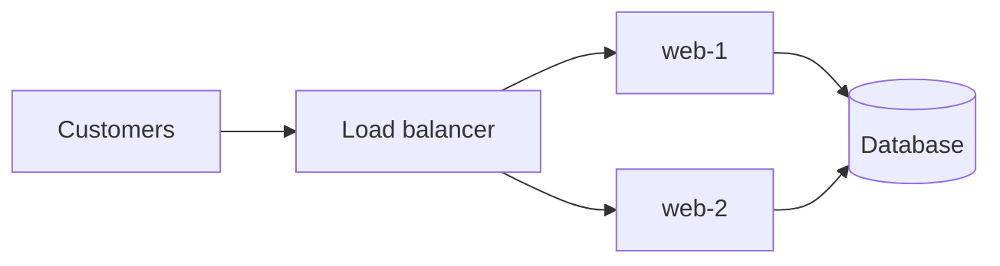

# Example Shop - Operations Guide

| Item | Details |
|------|---------|
| Document | Operations guide: servers, deployment and troubleshooting |
| Version | 1.0 |
| Last Update Date | 2026-01-15 |
| Author | Platform team |
| Status | **Draft.** For review |

## Contents

1. [Overview](#1-overview)
2. [Servers](#2-servers)
3. [Operations](#3-operations)

---

## 1. Overview

### 1.1 Purpose

This guide describes how the *Example Shop* web platform is deployed and operated. It is a sample file for the **Markdown to Word** converter.

### 1.2 Request Flow

Customers reach the shop through a load balancer, which spreads traffic across two web servers. Both servers read from one database.



## 2. Servers

### 2.1 Inventory

| Host | Role | IP Address | Port |
|------|------|------------|:----:|
| web-1 | Web server | `192.0.2.11` | 8080 |
| web-2 | Web server | `192.0.2.12` | 8080 |
| db-1 | Database | `192.0.2.21` | 5432 |

### 2.2 Directory Layout

```text
/srv/shop
├── app/        application release
├── config/     environment settings
└── logs/       application logs (rotated daily)
```

## 3. Operations

### 3.1 Deploying a Release

1. Copy the release archive to `/srv/shop/releases/`.
2. Point the `app` link to the new release.
3. Restart the service and check its status.

```bash
sudo systemctl restart shop
```

> **Note:** deploy to one web server at a time, so the other keeps serving customers. See [3.2](#32-troubleshooting) if the service does not start.

### 3.2 Troubleshooting

| Symptom | Likely Cause | Where to Look |
|---------|--------------|---------------|
| `502 Bad Gateway` | web server down | `systemctl status shop` on the node |
| Slow pages | database under load | database slow-query log |
| Disk filling | logs not rotated | `/srv/shop/logs` |
